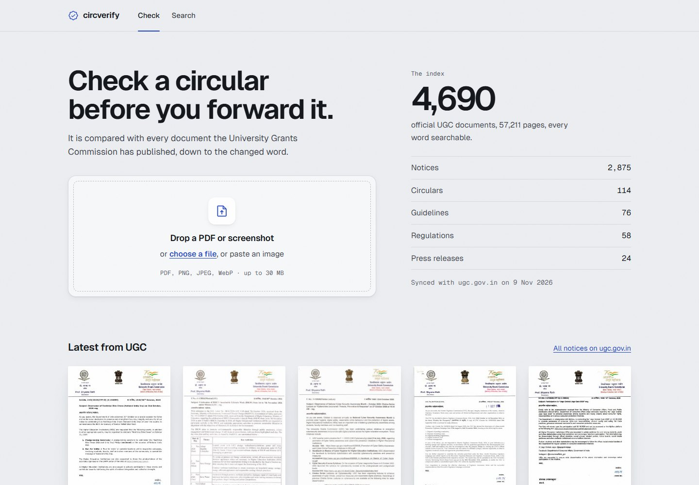

# Fake Government Circular Detector

Fake UGC notices spread on WhatsApp every admission and exam season: a deadline moved, a "registration fee"
payable on a lookalike website, a scholarship that never existed, typed onto real letterhead.

This project checks a document against an index of **every file the University Grants Commission has
published on ugc.gov.in**. It tells you whether the document is genuine, which official document it came
from, and exactly what was changed.


*A screenshot of UGC's 2026 Vigilance Awareness Week letter with a date painted over one line, checked
against the index. The demo edit was made for this README.*

```console
$ circverify verify forwarded.jpg
   ALTERED   forwarded.jpg

  Closely matches the official "UGC letter regarding: Observation of the Vigilance Awareness Week from
  26th October 2026 to 1st November 2026." (2026-10-22), but differs: 1 changed region on the page image.

Official record
  Published       2026-10-22
  Listed under    UGC / notices
  URL             https://www.ugc.gov.in/pdfnews/0192052_Vigilance-Awareness-Week_2026.pdf

Page images
  Submitted page 1 -> official page 1: 1 changed region (0.3% of the text area)
```

## Why it works this way

It does not try to judge whether a document *looks* fake. There is no dataset of real forged circulars,
and a classifier trained on fakes I generated myself would learn my forgery style and nothing else.

It answers a narrower question that can actually be checked: **did the issuer publish this?** That makes
the project mostly an index:

- **One issuer, completely.** All five UGC listings (notices, circulars, press releases, regulations,
  guidelines) are read from the JSON endpoints and tables behind the site. Every linked file is downloaded
  once and stored under its SHA-256, with the fetch history kept so a silently replaced PDF stays on record.
- **Exact and fuzzy matching.** A byte-identical file is matched by hash. A re-saved PDF, a screenshot or
  a single page is matched by per-page text fingerprints and page-image hashes.
- **Tamper detection by comparison, not by guessing.** Once the source document is found, the submission is
  diffed against it word by word and, on aligned page images, region by region.

## The index

| | |
|---|---|
| Listing entries crawled | 3,147 (notices 2,875, circulars 114, guidelines 76, regulations 58, press releases 24) |
| Files they link to | 4,985 |
| Downloaded and indexed | 4,690 unique files, 4.5 GB, none unreadable |
| Pages indexed | 57,211, of which 11,584 (20%) are scans with no text layer |
| Dead links | 337 on ugc.gov.in today; 76 recovered from the Wayback Machine, 261 still missing |
| Snapshot | 9 Nov 2026 |

`manifest/ugc.csv` lists every file UGC links to, with its listing title, publish date, URL and SHA-256,
so a file's hash can be checked against it without installing anything.

## What the verdicts mean

| Verdict | Meaning |
|---|---|
| **Verified: exact copy** | Byte-for-byte a file UGC published. The report names the notice and links the official file. |
| **Verified: same content** | Same text, or the same page image, as an official file, saved or captured differently (re-saved PDF, screenshot, one page of a longer file). |
| **Altered** | It is an official document, but something changed. Each text change is listed with what the official file says, and changed areas of the page are boxed. |
| **Not found** | Nothing in the index matches: it is not among the files UGC has published on its website. On its own that is not proof of forgery (see [limitations](#limitations)), but a real UGC notice is on ugc.gov.in. |

Text changes are rated by what they touch: numbers and dates, links and contact details, money, and words
that flip meaning ("not", "extended", "unrecognised"). Those are what fake notices change.

## How it works

```
ugc.gov.in listings ─► crawler ─► files/ab/<sha256>          content-addressed, every fetch recorded
                                       │
                                       ▼
                         indexer, for every page
                           text  ─► word 3-grams ─► 128-way MinHash
                           image ─► perceptual hash, difference hash, ink share
                           SQLite FTS5 full-text index
                                       │
submission ─► SHA-256 lookup ──────────┤ hit: verified, exact copy
          └─► candidates from MinHash ∪ full-text ∪ page-image hash
              └─► exact re-scoring: share of the submission's 3-grams found in each candidate
                  └─► word diff + aligned pixel diff of the best few ─► verdict and report
```

A few details that mattered on real data:

- **Page-image hashes are weak on their own.** UGC letters share a template, so among just 60 first pages
  there were 143 pairs of *different* letters with nearly identical perceptual hashes. Hashes only nominate
  candidates; the decision comes from a pixel comparison.
- **The pixel comparison is calibrated on real UGC pages.** Pages are compared at the submission's own
  resolution, each 12 px cell may shift up to 2 px to absorb rescaling drift, and the change threshold
  adapts to each page's measured noise. On real first pages, the share of text cells that changed was:

  | Comparison | Share of text cells changed |
  |---|---|
  | Genuine WhatsApp-quality screenshot | at most 0.8% |
  | Screenshot with a date painted in | 0.1% to 11% |
  | Real letterhead, fabricated body | at least 26% |
  | A different UGC letter on the same template | at least 37% |

  Anything above 20% is treated as a different page.
- **Text outranks pictures.** When a submission has readable text and that text does not match, a similar
  layout cannot make it a match.
- **Edits that leave the text alone are caught.** A white box pasted over a date keeps the original text in
  the PDF's text layer, so text comparison says "identical". The page image disagrees, and that is reported.
- **Some letters are reissued every year** with new dates (Vigilance Awareness Week, Rashtriya Ekta Diwas).
  A genuine new letter checked against a stale index looks like last year's letter with the dates changed,
  so the report says when only dates differ and suggests `verify --refresh`.

## Evaluation

There are no real forgeries to test on, and the method does not need any: it never learns what a forgery
looks like. What needs measuring is whether genuine copies survive the ways people pass documents around,
whether edits to real documents are caught and located, and whether fabrications on real letterhead are
rejected. `scripts/evaluate.py` samples official PDFs from the index, builds those variants and checks each
one against the full index.

150 official PDFs sampled at random (seed 7) from the 4,547 PDFs indexed when the run started. No OCR. Each file was turned into the variants below and checked against the full index.

| Variant | Cases | Expected verdict | Correct | Text-layer PDFs | Scanned PDFs |
|---|---:|---|---:|---:|---:|
| exact copy | 150 | VERIFIED_EXACT | 150/150 (100%) | 86/86 (100%) | 64/64 (100%) |
| page 1 saved as new PDF | 150 | VERIFIED_CONTENT or VERIFIED_EXACT | 149/150 (99%) | 86/86 (100%) | 63/64 (98%) |
| WhatsApp-style JPEG screenshot | 149 | VERIFIED_CONTENT | 148/149 (99%) | 85/85 (100%) | 63/64 (98%) |
| screenshot with a date painted in | 143 | ALTERED | 129/143 (90%) | 72/81 (89%) | 57/62 (92%) |
| PDF edited: white-out + typed text | 143 | ALTERED | 140/143 (98%) | 81/81 (100%) | 59/62 (95%) |
| letterhead kept, body fabricated | 149 | NO_MATCH | 149/149 (100%) | 85/85 (100%) | 64/64 (100%) |

Of the edited copies flagged as altered, **266/269** had a marked region overlapping the edit.

**Genuine documents missing from the index.** Each sampled file was also checked with itself removed from the index, which is what happens when a real notice is newer than the last crawl:

- NO_MATCH: 135 (90%)
- ALTERED: 14 (9%)
- VERIFIED_CONTENT: 1 (1%)

`VERIFIED_CONTENT` here means the issuer published the same document again under another entry (common for re-posted notices). `ALTERED` means a close relative exists, usually the same letter issued for another year, which is why the report tells you to refresh the index before concluding a recent notice was edited.

Median time per check: 0.99 s (90th percentile 1.62 s).

Painted-in edits are the weak spot: 14 of 143 were missed. Nine came back as "same content", typically when
the painted text landed on a table or a mostly empty line and changed too little ink to stand out from the
page's own recompression noise. Five were not found at all, including one document whose first page fails
every image check. With OCR installed, the edited words also show up as text changes.

## The web page

`circverify serve` runs a local page at `http://127.0.0.1:8000`. Drop a PDF or screenshot on it, or paste an
image straight from the clipboard.



- **The case file.** The verdict, then the evidence: every text change shown as the official wording against
  the submitted wording, a swipe viewer that slides between the official page and the submission with
  changed regions boxed, and each changed region enlarged with the official line directly above the
  submitted one, so the difference can be read rather than hunted for.
- **The official source** sits beside it: the notice title, its date and listing, a button that opens the file on
  ugc.gov.in, and the file's SHA-256.
- **Not found** comes with next steps and a search box, because the useful follow-up is finding the real
  notice. `/search` searches every indexed page.
- **Download report** saves the same result as a single HTML file (fonts and page images inlined) that opens
  offline and can be shared.
- Nothing is loaded from another site and nothing is stored. Light and dark themes follow the system setting.

## Install and use

Python 3.11 or newer.

```bash
git clone https://github.com/anubhavdey0/fake-government-circular-detector
cd fake-government-circular-detector
python -m venv .venv
source .venv/bin/activate          # Windows: .venv\Scripts\activate
pip install -e ".[web]"

circverify crawl                   # first run: about an hour and 4.5 GB, at most 2 requests a second
circverify verify notice.pdf       # or a .jpg/.png screenshot
circverify serve                   # upload page at http://127.0.0.1:8000
```

The index lives in `%LOCALAPPDATA%\circverify` on Windows and `~/.local/share/circverify` elsewhere, not in
the working folder (it is several GB, and project folders are often synced). Set `CIRCVERIFY_DATA_DIR` or
pass `--data-dir` to put it somewhere else. Running `crawl` again only fetches what is new.

| Command | What it does |
|---|---|
| `circverify crawl` | Sync the listings, download new files, index them. `--wayback` recovers dead links from the Wayback Machine. |
| `circverify verify FILE` | Check a PDF or image. `--json` for machine output, `--html report.html` for a shareable report with page images, `--refresh` to sync first. Exit code 0 verified, 1 altered, 3 not found. |
| `circverify serve` | Local upload page. Files are checked in memory and never stored or sent anywhere. |
| `circverify search "words"` | Full-text search over every indexed page, to find the real notice on a topic. |
| `circverify stats` | What is in the index. |
| `circverify export manifest.csv` | Every listed file with its SHA-256. |
| `circverify index --reindex` | Rebuild fingerprints, for example after installing OCR. |

**OCR (optional, recommended).** About 20% of UGC's pages are scans with no text layer. They are
still matched by hash and by page image, but OCR adds text so that cropped screenshots and retyped copies
can be found too. Install [Tesseract](https://github.com/tesseract-ocr/tesseract) (with the Hindi pack if
you like), then `pip install -e ".[ocr]"` and `circverify index --reindex`.

## Limitations

- **Not found is not proof of forgery.** It means the document is not among the files UGC links from its
  listing pages. UGC publishes its notices there, so a "UGC notice" that is missing deserves suspicion, but
  a few documents live on other UGC portals that are not crawled.
- **Without OCR, a screenshot must show the whole page** to be matched by image. Cropped screenshots and
  photos of a printout (perspective, shadows, paper texture) need OCR to be found by their text.
- **The index is a snapshot.** Run `crawl` or `verify --refresh` before judging something issued recently.
- **English and Hindi versions are separate files.** A copy matches the language version UGC published.
- **Dead links.** 261 listed links no longer serve a file; those documents can only be checked if the
  Wayback Machine has a copy (`crawl --wayback`).
- **One issuer.** The design is issuer-agnostic, but only UGC is implemented. Depth first.

## Adding another issuer

Write `src/circverify/issuers/<name>.py` with a class that yields `Notice` records (title, date, list of
file URLs) from that issuer's listings, and register it in `issuers/__init__.py`. Everything downstream
(download, index, verify, web page) works unchanged. A state education department or a university that
publishes circulars on one site is a good next candidate.

## Project layout

```
src/circverify/
  issuers/ugc.py   listing parsers for the five UGC sources
  crawler.py       rate-limited downloads, soft-404 detection, Wayback recovery
  store.py         content-addressed file store
  db.py            SQLite schema: notices, links, fetch history, files, pages, FTS5
  extract.py       PDF/image to page text and renders (pypdfium2)
  fingerprint.py   shingles, MinHash, perceptual and difference hashes
  indexer.py       parallel indexing
  matcher.py       retrieval, re-scoring, verdict
  diff.py          word diff with severity, aligned pixel diff
  forensics.py     PDF metadata signals (editing tools, incremental saves, overlays)
  htmlreport.py    pages for the web app and the standalone --html report (one renderer for both)
  static/          app.css, app.js, Geist fonts (SIL OFL), Phosphor icons (MIT)
  web.py, cli.py
scripts/evaluate.py
tests/             unit and end-to-end tests on generated documents
```

## License

MIT. The bundled Geist fonts are under the SIL Open Font License and the Phosphor icons under MIT; their
licence files sit next to them in `src/circverify/static/`. The crawled documents belong to the University
Grants Commission and are not redistributed here; the manifest contains only their public URLs, titles,
dates and hashes.
