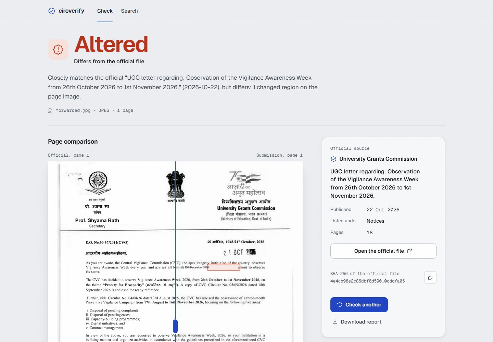
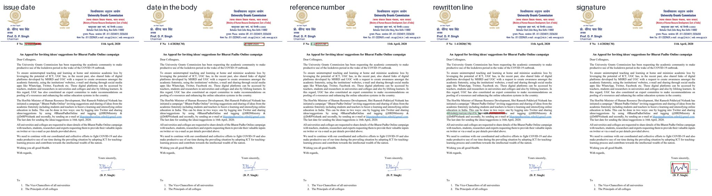

# Fake Government Circular Detector

Fake UGC notices spread on WhatsApp every admission and exam season: a deadline moved, a "registration fee"
payable on a lookalike website, a scholarship that never existed, typed onto real letterhead.

This project is an evidence-based verification tool for official circulars. It checks a document against an
index of **every file the University Grants Commission has published on ugc.gov.in** and answers, with the
evidence for each answer:

- does this circular exist, and did UGC publish it?
- has it been modified, and which parts differ?
- do its reference number and date match the official record?
- is it still current, or has a later notice corrected, extended or withdrawn it?
- where is the original?

It calls something fake only when it matches a fake that UGC or a fact-checker has publicly debunked, and it
gives no trust score: each check is reported on its own, with what it saw.

> Unofficial tool, not affiliated with the University Grants Commission.



*A screenshot of UGC's 2026 Vigilance Awareness Week letter with a date painted over one line, checked
against the index. The demo edit was made for this README.*

```console
$ circverify verify forwarded.jpg
   ALTERED   forwarded.jpg

  Closely matches the official "UGC letter regarding: Observation of the Vigilance Awareness Week from
  26th October 2026 to 1st November 2026." (2026-10-22), but differs: 1 changed region on the page image.

Official record
  Published       2026-10-22
  Listed under    UGC / notices
  URL             https://www.ugc.gov.in/pdfnews/0192052_Vigilance-Awareness-Week_2026.pdf
  SHA-256         4e4cb98e2c86dbf0d59076c3ff03f54363373d8db0876ffa393df0a30cddfa05

Page images
  Submitted page   Official page   Changed regions   Changed area   Result
               1               1                 1           0.3%   changed

Notes
  • Index last synced with the issuer's site on 2026-11-09.
  • The submission covers page(s) 1 of the official 18-page file.
```

## Why it works this way

It does not try to judge whether a document *looks* fake. There is no dataset of real forged circulars,
and a classifier trained on fakes I generated myself would learn my forgery style and nothing else.

It answers a narrower question that can actually be checked: **did the issuer publish this?** That makes
the project mostly an index:

- **One issuer, completely.** All five UGC listings (notices, circulars, press releases, regulations,
  guidelines) are read from the JSON endpoints and tables behind the site. Every linked file is downloaded
  once and stored under its SHA-256, with the fetch history kept so a silently replaced PDF stays on record.
- **Exact and fuzzy matching.** A byte-identical file is matched by hash. A re-saved PDF, a screenshot, a
  phone photo, a single page or pasted text is matched by per-page text fingerprints and page-image hashes.
- **Tamper detection by comparison, not by guessing.** Once the source document is found, the submission is
  diffed against it word by word and, on aligned page images, region by region.
- **"Fake" only with a public debunk behind it.** Documents that UGC or PIB Fact Check have called fake are
  kept in a separate store. A match there is the only way to get the word "fake" out of this tool.

## Why not just ask an AI chatbot?

A chatbot shown a forwarded circular judges whether it *looks* real. A good fake is built on a real UGC
letterhead with the real signature and reference-number format, and changes one date or adds one payment link:
it looks exactly like a genuine notice because almost all of it is one. Answering "is it real?" means comparing
against what UGC actually published, and much of that cannot be searched: 22,700 pages of UGC's documents are
scans without usable text, and 1,949 notices are no longer on the site at all.

| | A general-purpose chatbot | circverify |
|---|---|---|
| Source of truth | General knowledge, perhaps a web search | Every file UGC published, stored and hashed |
| A real letter with one date changed | Looks genuine | "Official 15 November 2026; this copy 25 November 2026", with the region boxed |
| What you can show others | An opinion | The official file, its SHA-256, a shareable receipt |
| When nothing matches | May guess "fake" from appearance | "Not found", and "fake" only for public debunks |
| Asked twice | Can answer differently | The same answer every time |
| Real but outdated | Rarely knows | Withdrawn, corrected or extended later; deadlines passed |
| Your document | Sent to an AI provider | Checked on the machine running circverify, not stored |

A language model is good at what comes after: explaining a circular, summarising or translating it. That is a
layer that can sit on top of this evidence; it should not decide the verdict.

## What the verdicts mean

| Verdict | Meaning |
|---|---|
| **Verified: exact copy** | Byte-for-byte a file UGC published. The report names the notice and links the official file. |
| **Verified: same content** | Same text, or the same page image, as an official file, saved or captured differently (re-saved PDF, screenshot, phone photo, one page of a longer file, pasted text). |
| **Matches, details unconfirmed** | A photo whose page is an official one, compared by image alone, or a screenshot with a line that differs slightly from the official page all along (marked in amber). Neither can rule out a small edit such as a changed digit, so the report links the official file and asks for the dates and amounts to be compared. With an OCR engine installed, the words are read and compared too, which can turn this into Verified or Altered. |
| **Altered** | It is an official document, but something changed. Each text change is listed with what the official file says, and changed areas of the page are boxed. |
| **Known fake** | It matches a document that UGC or PIB Fact Check publicly debunked. The report links the debunk. |
| **Not found** | Nothing in the index matches. That is not proof of forgery (see [limitations](#limitations)), but a real UGC notice is on ugc.gov.in. The report adds a few signals, clearly marked as hints. |

Qualifiers that can appear on a Verified result:

- **Withdrawn.** "Real, but withdrawn from ugc.gov.in on 3 Nov 2026": the file was published, but it has since
  disappeared from every UGC listing. Old notices get forwarded long after they stop applying.
- **No longer listed.** The file was published on ugc.gov.in before this index existed and has since been
  taken down; it is known from the Wayback Machine, and the report gives the date of its first capture.
- **Digitally signed.** If the PDF carries a signature, the report says who signed it, whether the signature
  is intact, whether anything was appended after signing, and whether the signer's certificate chains to a
  root of the India PKI (CCA India).

Text changes are rated by what they touch: numbers and dates, links and contact details, money, and words
that flip meaning ("not", "extended", "unrecognised"). Those are what fake notices change.

### Evidence at a glance

Every result starts with a checklist instead of a score: exact file match; official original found; the
reference number and the date on the letter against the official record; changes to the text (and how many
touch dates, numbers, amounts, links or meaning); the page image; the digital signature; the links and QR
codes; and whether the official document is still current. A score like "92/100" would suggest a certainty
the checks cannot give; a row that says "Official 15 November 2026; this copy 25 November 2026" does not.

For copies that are not byte-identical, a **Details compared** table puts the submitted file and the official
one side by side: reference number, date, signatory, pages, the software that wrote each file, creation and
modification dates. Metadata is easy to change, so differences there are leads, not proof.

### Still current?

A genuine circular can still mislead: an old deadline forwarded after it was extended, a notice a corrigendum
changed, a letter later withdrawn. The index links documents that **correct, amend, extend, replace or
withdraw** earlier ones, from two kinds of evidence kept with the link: a later document quoting the earlier
one's reference number next to words like "in supersession of", "corrigendum", "partial modification" or
"extension of the last date"; and a "Corrigendum…", "Extension of last date…" or "Revised…" title that closely
matches an earlier notice from the previous eighteen months. A verified result then shows "A later document
may update this one", with the quoted sentence. These links are heuristics and are worded as "may".

The report also lists the **dates in the official document**: deadlines (a date preceded by "last date", "on
or before", "not later than" and similar in the same sentence) and events ("held on", "with effect from"),
and whether each has passed. "This is real, but its last date was 15 November and has passed" is often the
most useful thing to know. Other official files with the **same text** (re-posts, copies under another
entry) are listed too.

## The index

| | |
|---|---|
| Listing entries crawled | 3,147 (notices 2,875, circulars 114, guidelines 76, regulations 58, press releases 24) |
| Files they link to | 4,985, of which 4,963 (99.6%) are downloaded (`circverify coverage`) |
| Dead links | 337 on ugc.gov.in today; 316 recovered from the Wayback Machine, 21 still missing |
| Archived documents no longer listed | 1,949 UGC files found in the Wayback Machine that no listing links to any more (backfilled) |
| Indexed | 6,683 unique files (4,924 listed today, 1,759 archived only), 7.7 GB; 86 unreadable (83 truncated archive captures, 3 password-protected) |
| Pages indexed | 96,518 |
| Pages read by OCR | 4,515: the first two pages of every scanned document and of every document whose text layer is garbled (legacy Hindi fonts, fonts without a character map); mean confidence 0.93 |
| Pages still without usable text | 19,070 (15,173 scan pages, 3,897 garbled), nearly all beyond page 2 of long documents; 65 first pages |
| Files with a reference number read | 2,044 |
| First Wayback capture known | 6,653 files, the earliest from August 2012 |
| Known fakes | 3 files from 3 PIB Fact Check debunks |
| Snapshot | 10 Nov 2026 |

`manifest/ugc.csv` is the open index: every file UGC links to, with its listing title, publish date, URL and
SHA-256, plus the archived UGC files (`source=archive`, fetched from the Wayback Machine). A file's hash can be
checked against it without installing anything. `docs/evaluation-cases.csv` is the open test set: every
evaluation case with the official file's hash, the variant, the expected and actual verdict. The variants are
regenerated from the seed by `scripts/evaluate.py`, so no document needs to be shared to reproduce it.

The crawler keeps the index honest over time:

- **Versions.** Every fetch is recorded with its hash. A re-check (`crawl --recheck`) sends `If-None-Match` and
  `If-Modified-Since`, so unchanged files cost one small request, and a file replaced under the same URL keeps
  both versions on record.
- **Withdrawals.** After a complete sync, notices that no longer appear in any listing are marked withdrawn
  with the date they disappeared. If one comes back, the mark is cleared.
- **Archive proof.** `crawl --scan-archive` reads the Wayback Machine's index for every file under UGC's
  document folders and records when the *document itself* was first captured. HTML captures are ignored,
  because ugc.gov.in answers a missing file with an HTML error page and status 200, and an archived error page
  proves nothing. A first capture is independent evidence that the file was public on that date.
- **Dead links and backfill.** `crawl --wayback` recovers dead links from that first real capture (the
  archive's "closest" capture is usually the error page from after the file was removed). `crawl --backfill N`
  downloads archived UGC files that are no longer listed anywhere, titled from their file names.
- **Schedule.** `circverify watch` re-runs the crawl every 6 hours and prints what is new.

## How it works

```
ugc.gov.in listings ─► crawler ─► files/ab/<sha256>          content-addressed, every fetch recorded
                                       │
                                       ▼
                         indexer, for every page
                           text  ─► word 3-grams ─► 128-way MinHash   (OCR for scans, optional)
                           image ─► perceptual hash, difference hash, ink share, letterhead hash
                           fields ─► reference number, date, subject, signatory
                           SQLite FTS5 full-text index
                                       │
submission ─► SHA-256 lookup ─────────────────────────────► hit: verified, exact copy
          ├─► photo/screenshot clean-up: find the sheet, flatten perspective and lighting, deskew
          ├─► PDF signature check (pyHanko)
          └─► candidates from reference number ∪ MinHash ∪ full-text ∪ page-image hash
              └─► exact re-scoring: share of the submission's 3-grams found in each candidate
                  └─► word diff + aligned pixel diff of the best few ─► verdict
                       └─► not verified? compare against debunked fakes ─► Known fake or Not found
```

A few details that mattered on real data:

- **Page-image hashes are weak on their own.** UGC letters share a template, so among just 60 first pages
  there were 143 pairs of *different* letters with nearly identical perceptual hashes. Hashes only nominate
  candidates; the decision comes from a pixel comparison.
- **The pixel comparison is calibrated on real UGC pages.** Pages are compared at the submission's own
  resolution, with the official page rendered at exactly the screenshot's width rather than resampled (many
  phone PDF viewers use the same PDFium engine, so glyph edges then line up). Each 12 px cell may shift up to
  2 px to absorb remaining drift, and the change threshold adapts to each page's measured noise. Rendering at
  the native width lowered that noise enough to catch 47 of 49 painted-in dates in a calibration sample,
  against 44 with a resampled render, with no extra false alarms on genuine copies. On real first pages, the
  share of text cells that changed was:

  | Comparison | Share of text cells changed |
  |---|---|
  | Genuine WhatsApp-quality screenshot | at most 0.8% |
  | Screenshot with a date painted in | 0.1% to 11% |
  | Real letterhead, fabricated body | at least 26% |
  | A different UGC letter on the same template | at least 37% |

  Anything above 20% is treated as a different page. A changed region is reported when one cell clearly
  stands out, or when a run of at least five neighbouring cells is moderately off (a typed-over line in a
  table is faint per cell but long). Below that, a **line to check** is a stretch of body text, about two
  words wide, whose mean difference reaches the page's threshold all along: new text typed over old text of
  the same density looks like that. It is never called an edit, but a screenshot with one is not called
  Verified either; it gets "Matches, details unconfirmed" with the line marked in amber. Emblems, logos and
  rules are left out (the official page is dense there and recompresses badly), and there is an absolute floor
  because coloured links on an otherwise clean copy recompress above it. On the 304 genuine forwards used to set
  it, none had a line to check, and the evaluation below gives exactly the same results with it as without.
- **Photos are aligned by features.** A phone photo of a printout is first warped flat from the sheet's four
  corners, the way scanner apps do it, and its lighting is evened out; the official page gets the same lighting
  correction, so grey artwork such as UGC's lotus footer is treated alike on both sides. If the classic
  alignment still is not clean, ORB keypoints and a RANSAC homography map the photo onto the official page
  before the pixel comparison. Screenshots (an upright page on black bars or a chat background) are cropped,
  never warped or relit.
- **Clean-up never gets the last word.** If cropping or straightening a picture misjudges the page (a cover
  with a solid grey panel looks like a screen's surround), retrieval also uses the hash of the picture exactly
  as submitted. A picture without text is compared in full against the closest eight candidates, not three,
  because letters on one template hash alike.
- **Text outranks pictures.** When a submission has readable text and that text does not match, a similar
  layout cannot make it a match.
- **Edits that leave the text alone are caught.** A white box pasted over a date keeps the original text in
  the PDF's text layer, so text comparison says "identical". The page image disagrees, and that is reported.
- **Garbled text layers are treated as scans.** About 4,000 UGC pages carry a text layer that extracts as
  nonsense (old Hindi typing fonts, embedded fonts with no character map). Indexing that text would make
  matching worse, so those pages are scored for readability and handled like scans.
- **Some letters are reissued every year** with new dates (Vigilance Awareness Week, Rashtriya Ekta Diwas).
  A genuine new letter checked against a stale index looks like last year's letter with the dates changed,
  so the report says when only dates differ and suggests `verify --refresh`.

### Known fakes

`circverify fakes sync` searches PIB Fact Check's public Telegram channel for posts that mention UGC and
stores the images attached to them. `circverify fakes add` registers a debunked file by
hand, with the debunk's URL and who issued it. Before storing anything, both refuse a file that matches an
official document, so a mistaken debunk cannot turn a real notice into a "fake".

Fact-check posts usually show the fake inside a branded card with a red FAKE stamp. The card, the stamp and
the background are cut away so that what is indexed is the notice itself, and a forwarded copy of the bare
notice still matches.

The fake store is only consulted when nothing official verifies the submission. A genuine notice can never
be called fake because it resembles a debunked one.

### Signals, not a verdict

When a document does not verify, the report lists hints that a reader can check for themselves. Each is
measured against what UGC itself does, not against a list of guesses:

- **Links, e-mail addresses and QR codes.** Every link in the text and every QR code on the page (decoded
  with OpenCV) is sorted by its domain: UGC's own, an Indian government or academic domain (gov.in, nic.in,
  ac.in, which only such bodies can register), a link shortener that hides its destination, a **lookalike**
  (ugc-gov-in.com, ugc.gov.in.verify-now.com, one or two typos away, or look-alike characters), a domain that
  UGC's own documents use, or none of these. A fake that wants money usually sends people to a lookalike site,
  and the domain is the one thing a forger cannot copy from the real notice. Which domains count as "UGC uses
  it" is learned from the index: UGC's NET portal is ugcnetonline.in, which a naive "contains ugc" rule would
  flag. For an altered copy, only links the official file does not have are reported.
- **The reference number** printed on it belongs to a different official document, or to none.
- **The letterhead** resembles the letterheads on UGC's own documents (typed onto a copied letterhead), or not.
- **The page layout** (margins, letterhead and footer bands, number and spacing of lines, rules) is compared
  with UGC's own first pages by distance to the nearest of them. The score is calibrated on UGC's documents,
  so "unusual" means stranger than 99.5% of UGC's own pages, and the report names the measurements that
  differ most. No forgeries are needed to train it.
- **The software that made the file.** For a PDF, the producer is compared with the tools that wrote UGC's
  own PDFs: Canva or Photoshop, which none of UGC's PDFs were made with, is worth noting; iLovePDF, which UGC
  itself used for 101 of its PDFs, is reported as meaning little. For a picture, the EXIF and XMP metadata are
  read: an image editor in the "Software" field is noted (screenshots and phone photos do not normally pass
  through one). Incremental saves and overlay annotations in a PDF are noted too.
- **Dates.** The PDF's creation date is before the date written on the letter, or long after it.

None of these changes the verdict, and none uses the word "fake". A real letter can be re-saved in Canva by
whoever forwarded it.

## Design choices

- **A modular monolith on SQLite.** One Python package, one SQLite file (WAL mode, FTS5 for search) and a
  content-addressed folder of original files. At seven thousand documents and a hundred thousand pages this
  answers a check in a few seconds on a laptop, installs with `pip`, and backs up by copying a folder. The
  storage layer is small enough to move to PostgreSQL and object storage if the corpus grows by orders of
  magnitude; nothing above it would change.
- **Originals are kept, not just hashes.** A hash proves identity but cannot show what changed; the stored
  file is what the side-by-side comparison, the key dates and the relations are read from. Every file keeps
  its provenance: which listing linked it, when it was fetched, from where (live site or Wayback Machine).
- **No language model in the decision.** Crawling, matching, comparison and verdicts are deterministic, and
  the explanations are written from the evidence itself ("official 15 November 2026; this copy 25 November
  2026"), so they cannot invent anything. A model could summarise or translate an official circular later,
  as a separate layer that never touches the verdict.
- **Several independent checks, no fused score.** Hash, text, page image, reference number and date,
  signature, links, metadata and layout are each reported on their own (see "Evidence at a glance").
- **Text comparison treats critical fields separately.** The diff is word-level and every change is rated
  by what it touches; a semantic-similarity score would call "15 December" and "30 December" the same
  sentence, which is exactly the edit a forger makes.
- **No error level analysis (ELA).** Forwarded copies are recompressed by every chat app on the way, which
  is what ELA reacts to; comparing against the original page is a direct test instead of an indirect one.
- **The only learned model is trained on real documents.** The layout hint is a nearest-neighbour score
  calibrated on UGC's own first pages; no classifier is trained on forgeries, so there is no
  train/test leakage between variants of one circular to worry about.

## Evaluation

There are no real forgeries to train on, and the method does not need any: it never learns what a forgery
looks like. What needs measuring is whether genuine copies survive the ways people pass documents around, whether
edits to real documents are caught and located, and whether things UGC never published are kept out.
`scripts/evaluate.py` samples official PDFs from the index, builds those variants, and checks each one against
the full index; the most important number is the first one.

100 official UGC PDFs sampled at random (seed 7) from the 4,922 indexed PDFs UGC currently lists, 3 debunked fakes from PIB Fact Check, and 40 genuine NTA circulars. No OCR. Every case is checked against the full index.

| Headline | Result |
|---|---|
| False verified: not an official UGC document, but called Verified | **0 of 448** (0.0%) |
| Altered notices caught (Altered or Known fake) | 253 of 285 (89%); 25 more matched with details unconfirmed, none verified |
| Edits caught with a marked region on the edit | 186 of 186 (mean IoU 0.59) |
| Flagging "not verified" against "not official": precision / recall / F1 | 0.794 / 1.000 / 0.885 |
| Genuine copies not verified (false-positive rate) | 116 of 497 (23.3%), of which 99 matched but with details unconfirmed |
| Original found among the top 1 / top 3 candidates (published and forwarded copies) | 97.0% / 97.0% |
| Index coverage of files UGC lists | 99.6% |
| Median time per check | 3.92 s (90th percentile 8.43 s), measured on an otherwise idle laptop; the latest run shared the machine with other work and gave the same results more slowly |

| Group | Variant | Expected | Correct | Text-layer PDFs | Scanned PDFs |
|---|---|---|---:|---:|---:|
| 1. Published copy | exact copy | VERIFIED_EXACT | 100/100 (100%) | 76/76 (100%) | 24/24 (100%) |
| 1. Published copy | page 1 saved as a new PDF | VERIFIED_CONTENT or VERIFIED_EXACT | 100/100 (100%) | 76/76 (100%) | 24/24 (100%) |
| 2. Forwarded | WhatsApp-quality JPEG | UNCONFIRMED_MATCH or VERIFIED_CONTENT or VERIFIED_EXACT | 98/99 (99%) | 74/75 (99%) | 24/24 (100%) |
| 2. Forwarded | phone screenshot with black bars | UNCONFIRMED_MATCH or VERIFIED_CONTENT or VERIFIED_EXACT | 93/99 (94%) | 70/75 (93%) | 23/24 (96%) |
| 2. Forwarded | angled phone photo | UNCONFIRMED_MATCH or VERIFIED_CONTENT or VERIFIED_EXACT | 89/99 (90%) | 67/75 (89%) | 22/24 (92%) |
| 3. Altered | screenshot with a date painted in | ALTERED | 91/95 (96%) | 67/71 (94%) | 24/24 (100%) |
| 3. Altered | PDF edited: white-out + typed text | ALTERED | 95/95 (100%) | 71/71 (100%) | 24/24 (100%) |
| 3. Altered | phone photo of an edited printout | ALTERED | 67/95 (71%) | 54/71 (76%) | 13/24 (54%) |
| 4. Debunked fakes | fake, forwarded copy | KNOWN_FAKE | 12/12 (100%) | n/a | n/a |
| 4. Debunked fakes | fake, store switched off | ALTERED or NO_MATCH | 12/12 (100%) | n/a | n/a |
| 5. Other issuer | NTA circular | NO_MATCH | 40/40 (100%) | n/a | n/a |
| Stress | UGC letterhead, fabricated body | NO_MATCH | 99/99 (100%) | 75/75 (100%) | 24/24 (100%) |
| Stress | genuine UGC notice missing from the index | ALTERED or NO_MATCH or UNCONFIRMED_MATCH or VERIFIED_CONTENT | 100/100 (100%) | 76/76 (100%) | 24/24 (100%) |

**Genuine notices missing from the index** (what a stale index sees): NO_MATCH 83, ALTERED 17. Altered here means a close relative exists, usually the same letter issued for another year; the report shows the differences and suggests refreshing the index.

What the numbers say:

- **Nothing that UGC did not publish was called Verified**: not an edited copy, not a debunked fake, not a
  fabricated letter on real letterhead, not another issuer's circular. This is the error that matters most for a
  verification tool, so the design gives it up last.
- **Photos are honest about their limits.** A photo of a page lined up by its image alone comes back as
  "Matches, details unconfirmed", with the official file to compare against. That is why 99 genuine phone photos
  and screenshots are counted as "not verified" (the 0.79 precision above) and why 25 photographed or lightly
  painted edits are not called Altered either: at phone-photo quality, a changed digit can vanish into the noise.
  With an OCR engine installed, the photo's words are read and compared, which confirms or rejects the details.
- **Where it misses.** A phone photo of an edited printout is the hardest case: 67 of 95 are called Altered,
  21 matched but unconfirmed, 7 not found; scanned originals do worst (13 of 24). A handful of genuine
  copies (17 of 497) were not found (11) or flagged as altered by mistake (6).
- **Edits are located.** Every edit that was called Altered had a marked region on the edited line (186 of 186;
  the mean intersection-over-union of 0.59 reflects boxes drawn around changed words rather than the whole line).
- **A stale index** (the genuine notice removed from the index, as if it were newer than the last crawl) gives
  Not found 83 times and Altered 17 times, the latter when a near-identical letter from another year exists.
  The report says so and suggests refreshing the index.

Times are for a laptop (Intel i5-13450HX) while other work was running.

### Targeted tampering

`scripts/tamper_benchmark.py` makes the five edits a forger would make to a real circular, at the real location of
each element (found from the character positions in the PDF's text layer): the issue date, a date in the body,
the reference number, one rewritten line of text, and the signature. Each copy is checked as a WhatsApp-quality
JPEG.

40 text-layer UGC circulars with a reference number, date and signatory line, sampled at random (seed 11); five edits each where the element could be located, saved as WhatsApp-quality JPEGs and checked against the full index without OCR. Synthetic, controlled edits.

| Edit | Cases | Altered | Matches, details unconfirmed | Still called Verified | Region marked on the edit | Mean IoU (when marked) |
|---|---:|---:|---:|---:|---:|---:|
| issue date | 40 | 39/40 (98%) | 1 | 0 | 38/40 (95%) | 0.57 |
| date in the body | 21 | 21/21 (100%) | 0 | 0 | 21/21 (100%) | 0.59 |
| reference number | 39 | 38/39 (97%) | 0 | 0 | 38/39 (97%) | 0.59 |
| rewritten line | 40 | 34/40 (85%) | 5 | 1 | 35/40 (88%) | 0.35 |
| signature | 27 | 27/27 (100%) | 0 | 0 | 27/27 (100%) | 0.76 |

Overall: 159/167 edited copies called Altered; 6 called "Matches, details unconfirmed"; 1 still called Verified. A marked region counts the red changed regions and the amber lines to check.



Dates, reference numbers and signatures are caught and located almost every time. The hard case is a **rewritten
line**: new text typed over old text of the same density changes each small cell only a little, so no cell stands
out from the page's own compression noise. The first version of this benchmark let 4 of the 40 rewritten lines
pass as Verified. The **line to check** (see How it works) was added for exactly this: a stretch of body text that
differs a little all along. Three of those four now come back as "Matches, details unconfirmed" with the line
marked in amber (one mark sits just right of the nominal edit, where the new sentence ran over the old text). One
still passes as Verified: its line differs too little to separate from compression noise without also flagging
genuine forwards. It is the only false verification in any of the benchmarks.

### The three datasets

1. **Authentic documents**: the index itself, 6,683 files straight from ugc.gov.in (and the Wayback Machine for
   dead links and removed notices), listed with their hashes in `manifest/ugc.csv`.
2. **Controlled tampering**: the variants built by `scripts/evaluate.py` and `scripts/tamper_benchmark.py`,
   labelled as synthetic. `docs/evaluation-cases.csv` and `docs/tampering-cases.csv` list every case; the seeds
   regenerate them exactly.
3. **Real-world suspicious documents**: fakes publicly debunked by PIB Fact Check (`circverify fakes sync`), and
   the documents readers report (`circverify reports export`), kept apart from verified findings.

Nothing is trained on the tampered variants, so the usual trap (variants of the same circular on both sides of
a train/test split) does not arise; the only fitted component, the layout hint, is calibrated on UGC's own
documents. Outside forgeries can be added with `scripts/evaluate.py --external DIR` (a folder with
`manifest.csv` of `file,expected`); edits made by someone other than the author are the strongest test this
evaluation does not yet have.

## The web page

`circverify serve` runs a local page at `http://127.0.0.1:8000`. Drop a PDF, screenshot or photo on it, paste
an image straight from the clipboard, or paste the text of a forwarded message.


- **The case file.** The verdict, then the evidence: every text change shown as the official wording against
  the submitted wording, a swipe viewer that slides between the official page and the submission with
  changed regions boxed, and each changed region enlarged with the official line directly above the
  submitted one, so the difference can be read rather than hunted for.
- **The official source** sits beside it: the notice title, its date and listing, a button that opens the file on
  ugc.gov.in, and the file's SHA-256. If the Wayback Machine's first capture of the file is known
  (`crawl --scan-archive`), the report gives that date too.
- **Not found** comes with next steps and a search box, because the useful follow-up is finding the real
  notice. `/search` searches every indexed page.
- **Receipts.** "Share a receipt" creates a short link (`/r/<id>`) with the verdict, the official document or
  debunk, and the list of changes, to post back into the group where the document was circulating. The
  receipt stores the result and the file's hash, never the file.
- **Download report** saves the same result as a single HTML file (fonts and page images inlined) that opens
  offline.
- **Search and the registry.** `/search` finds documents by words or by reference number ("1-15/2026"),
  with filters for listing, date range and status (listed today, withdrawn, archived). With no words it is
  the public registry: every document, newest first, each with a link to its hash check. `/api/search` returns
  the same as JSON.
- **Several files at once.** Drop up to twenty files and get one table: verdict and official document for
  each. `circverify verify FOLDER --csv results.csv` does the same from the command line.
- **A link instead of a file.** Paste a link to a PDF or image. A link UGC lists is answered from the index
  without downloading anything; any other link is fetched once (http(s) only, no private or local addresses,
  re-checked at every redirect, 30 MB at most), and the link's own website is checked like any other link:
  a PDF on ugc-gov-in.com is flagged before its content is even compared.
- **`/feed.xml`** is an Atom feed of new UGC documents as the crawler finds them, and **`/coverage`** shows
  what is indexed and where the blind spots are.
- **Report it.** A document that is not verified has a "Report it" form: where it was seen, a note, and a
  link to a debunk if the reader knows one. Reports go to a review queue (`circverify reports list`), are
  counted when several people send the same file, and never change a verdict. A maintainer can promote a
  report to a known fake only by attaching a public debunk URL (`circverify reports promote`), with the same
  refusal of anything that matches an official document; `circverify reports export` writes the queue out
  as a dataset of documents that actually circulated, the data a classifier would need one day. A file that
  verifies as official cannot be reported at all.
- **Share on WhatsApp.** A receipt can be shared straight to WhatsApp, where the forward came from.
- **`/v/<sha256>`** confirms a single file by hash. `circverify qr FILE --base-url https://…` prints a QR
  code that opens this page, for an issuer that wants to put a verification code on its circulars.
- Nothing is loaded from another site, and uploads are checked in memory and not kept (a report, sent on
  purpose, is the exception). Light and dark themes follow the system setting.

### WhatsApp and Telegram bots

Fake circulars spread in WhatsApp family and college groups, so that is where a check helps most. Both bots
take a photo, a PDF or forwarded text and reply with the verdict, the official link or the debunk, the main
changes, any lookalike link, and a line saying it is an unofficial check. Replying "report" (optionally with
where it was seen: "report college group") files the last document for review.

**WhatsApp** uses Meta's WhatsApp Cloud API. The webhook is served by `circverify serve` when these are set:

```bash
export CIRCVERIFY_WHATSAPP_TOKEN=<access token of the WhatsApp Business account>
export CIRCVERIFY_WHATSAPP_PHONE_ID=<phone number ID that sends replies>
export CIRCVERIFY_WHATSAPP_VERIFY_TOKEN=<any secret; enter it again in the Meta app's webhook settings>
export CIRCVERIFY_WHATSAPP_APP_SECRET=<Meta app secret; every delivery's signature is checked with it>
export CIRCVERIFY_PUBLIC_URL=https://verify.example.org   # optional: adds receipt links to replies
circverify serve --host 0.0.0.0
```

Point the Meta app's webhook at `https://<public address>/whatsapp/webhook` and subscribe it to `messages`.
Meta only calls HTTPS addresses, so a laptop needs a tunnel such as cloudflared. Deliveries without a valid
`X-Hub-Signature-256` are refused, repeated deliveries are answered once, and the check runs after Meta has
had its quick 200. `CIRCVERIFY_WHATSAPP_API_VERSION` overrides the Graph API version (default `v23.0`).

**Telegram** needs no public address; it uses long polling:

```bash
export CIRCVERIFY_TELEGRAM_TOKEN=<token from @BotFather>
circverify telegram --public-url https://your-server.example   # --public-url is only for receipt links
```

## Install and use

Python 3.11 or newer.

```bash
git clone https://github.com/anubhavdey0/fake-government-circular-detector
cd fake-government-circular-detector
python -m venv .venv
source .venv/bin/activate          # Windows: .venv\Scripts\activate
pip install -e ".[all]"            # or ".[web]" for the minimum

circverify crawl                   # first run: about an hour and 4.5 GB, at most 2 requests a second
circverify verify notice.pdf       # or a .jpg/.png screenshot or photo
circverify verify --text "UGC extends the last date ..."
circverify serve                   # upload page at http://127.0.0.1:8000
```

The index lives in `%LOCALAPPDATA%\circverify` on Windows and `~/.local/share/circverify` elsewhere, not in
the working folder (it is several GB, and project folders are often synced). With Python from the Microsoft
Store, Windows quietly redirects that folder to
`%LOCALAPPDATA%\Packages\PythonSoftwareFoundation.Python.3.x_…\LocalCache\Local\circverify`. Set
`CIRCVERIFY_DATA_DIR` or pass `--data-dir` to put it somewhere else. Running `crawl` again only fetches what is
new.

| Command | What it does |
|---|---|
| `circverify crawl` | Sync the listings, download new files, index them. `--recheck` re-validates files already downloaded, `--wayback` recovers dead links, `--scan-archive` records first Wayback captures, `--backfill N` downloads archived files no longer listed, `--ocr` OCRs new scans. |
| `circverify watch` | Run the crawl every 6 hours (`--every`) and print what is new. |
| `circverify verify FILE…` | Check PDFs or images; several files or a folder give a summary table (`--csv` to save it). `--text "…"` (or `--text -` for stdin) checks pasted text, `--url LINK` the document at a link. `--json`, `--html report.html`, `--refresh` to sync first, `--ocr` to OCR the input if nothing else matched. Exit code 0 verified, 5 matches with details unconfirmed, 1 altered, 2 unreadable, 3 not found, 4 known fake (the most serious one for several files). |
| `circverify serve` | Local upload page. |
| `circverify telegram` | Telegram bot (token in `CIRCVERIFY_TELEGRAM_TOKEN`). |
| `circverify search "words"` | Full-text search over every indexed page, to find the real notice on a topic. |
| `circverify fakes sync` / `add` / `list` | Import debunks from PIB Fact Check, register a debunked file, list them. |
| `circverify reports list` / `promote` / `dismiss` / `export` | The review queue of documents people reported. `promote ID --url DEBUNK --source NAME` makes one a known fake. |
| `circverify stats`, `circverify coverage` | What is in the index, and how much of what UGC lists it covers. |
| `circverify export manifest.csv` | Every listed file with its SHA-256. |
| `circverify qr FILE --base-url URL` | A QR code that opens the hash check for that file. |
| `circverify index --enrich --ocr` | Read fields (reference number, domains, layout) and OCR scanned pages of files already indexed. `--relations` relinks documents that amend or replace earlier ones (also done after every index run). `--reindex` rebuilds everything. |

**OCR (optional, recommended).** About 24% of UGC's pages have no usable text. They are still matched by
hash and by page image, but OCR adds text so that cropped screenshots, photos and retyped copies can be found
by their wording too. Two engines are supported:

- **Tesseract** (recommended, fast). Install [Tesseract](https://github.com/tesseract-ocr/tesseract) with the
  Hindi pack, then `pip install -e ".[ocr]"`. It is used automatically once it is on the PATH.
- **RapidOCR** (pure pip, no system install): `pip install -e ".[ocr-pip]"` and set
  `CIRCVERIFY_OCR_ENGINE=rapidocr`. It reads English and Hindi, but on a laptop CPU it takes 10 to 35 seconds
  a page, so it is only used when chosen explicitly.

Then `circverify index --enrich --ocr` OCRs the first pages of every scanned document (`--ocr-pages` for
more). At check time OCR runs only as a fallback, when nothing matched without it.

**Signatures (optional).** `pip install -e ".[signatures]"` adds pyHanko. Signed PDFs then get a line saying
who signed, whether the signature is intact, whether it covers the whole file, and whether the signer's
certificate chains to a CCA India root. The roots (CCA India 2014, 2015 SPL, 2022, 2022 SPL) and a few
licensed-CA certificates are bundled in [`src/circverify/trust/`](src/circverify/trust/README.md), downloaded
from cca.gov.in and, where possible, matched byte for byte against the copies signed UGC files carry. The chain
is checked as of the signing date the signature states, since certificates expire and old circulars were
signed with certificates valid then; revocation is not checked (it needs the network). More roots can be
listed in `CIRCVERIFY_TRUST_ROOTS` (separated like `PATH`). The operating system's trust store is deliberately
not used, so the answer does not depend on the machine.

Few UGC files are signed: 42 of 6,704 PDFs, nearly all Gazette notifications signed by the Government of India
Press. 33 chain to a CCA India root; 2 are intact but their chain cannot be completed offline (an intermediate
certificate is neither embedded nor published by the CCA); in 4 the content is unchanged but the signature value
does not verify; 3 could not be parsed.

### Running it as a service

`docker compose up -d` runs the website and the crawler (every 6 hours) from one image, with HTTPS and the
Telegram bot as options; `deploy/` also has systemd units for a server without Docker. See
[docs/deploy.md](docs/deploy.md) for the full guide, including the WhatsApp webhook and a free setup on
Oracle Cloud's Always Free tier (`scripts/pack_data.py` moves the index; `deploy/oracle/setup.sh` prepares the
server). A public server limits checks per address and turns new checks away while the server is full.

## Ethics and legal

- **Polite crawling.** The crawler reads `robots.txt` before fetching (ugc.gov.in serves none today), sends a
  User-Agent that names the project and links here, waits at least 0.5 s between requests across all workers,
  and re-checks files with conditional requests so unchanged files are not downloaded again.
- **Unofficial, and says so.** Every page, report and receipt carries the line "Unofficial tool, not
  affiliated with the University Grants Commission".
- **"Fake" only on a public debunk.** Missing from the index is "Not found", never "fake". Forensic signals
  are shown as hints and never change a verdict.
- **Terms of use.** ugc.gov.in has no terms-of-use page and its copyright-policy link returns an error page.
  Its [disclaimer](https://www.ugc.gov.in/Home/Disclaimer) does not forbid automated access. It says that
  users may not "change, modify or prepare derivative works" from the site's content. This project does not
  redistribute UGC's files: each user's crawler downloads its own copy for comparison, and the published
  manifest holds only URLs, titles, dates and hashes. The same disclaimer says that for Acts, Rules and
  Regulations the printed and Gazette copies are the authentic versions, not the website. I am not a lawyer;
  treat this as a starting point.
- **Privacy.** Uploads are checked in memory. Two things are stored, and only when someone asks: a receipt,
  which holds the result and the file's hash but not the file; and a report, which keeps the file and the
  reporter's notes for review (the form says so, and asks for no personal details). The chat bots remember
  each chat's last document for 30 minutes, in memory, so that "report" can refer to it.

## Limitations

- **Not found is not proof of forgery.** It means the document is not among the files UGC links from its
  listing pages. UGC publishes its notices there, so a "UGC notice" that is missing deserves suspicion, but
  a few documents live on other UGC portals that are not crawled.
- **The known-fakes list is small.** Three files from PIB Fact Check so far. Most fakes are new, so most will
  come back as "Not found", which is the honest answer.
- **OCR is partial, and English only.** The first two pages of every scanned document are OCR'd (4,515 pages)
  with RapidOCR's English model, so Hindi text on those pages is not read, and later pages of long scans
  (about 19,000) are not read at all. `index --enrich --ocr --ocr-pages N` reads more; Tesseract with the Hindi
  language pack would read the Hindi too. A cropped screenshot of an unread page can only be found by page
  image, which needs most of the page.
- **The index is a snapshot.** Run `crawl` or `verify --refresh` before judging something issued recently.
- **English and Hindi versions are separate files.** A copy matches the language version UGC published.
- **Dead links.** 21 listed links serve no file and have no usable Wayback Machine capture, so those documents
  cannot be checked.
- **Signature trust is checked offline.** Revocation is not checked, and a chain whose intermediate
  certificate is neither in the PDF nor bundled cannot be confirmed (see above).
- **Hints are hints.** The layout score flags about 1 in 200 of UGC's own first pages by construction, the
  domain check knows only the domains UGC's documents mention, and metadata is stripped by most chat apps.
- **The WhatsApp bot needs a Meta business setup** (a WhatsApp Business account, an app, a phone number) and a
  public HTTPS address. Its tests use payloads in the documented Cloud API format against a mock Graph API,
  not a live number.
- **One issuer.** The design is issuer-agnostic, but only UGC is implemented. The next issuer is a state
  education department or a university that publishes circulars on one site (Maharashtra's School Education
  Department and SPPU have both been suggested); regional-language circulars will need Marathi OCR, which the
  RapidOCR engine can add.

## Adding another issuer

Write `src/circverify/issuers/<name>.py` with a class that yields `Notice` records (title, date, list of
file URLs) from that issuer's listings, and register it in `issuers/__init__.py`. Everything downstream
(download, index, verify, web page, bot) works unchanged. A state education department or a university that
publishes circulars on one site is a good next candidate.

## Project layout

```
src/circverify/
  issuers/ugc.py   listing parsers for the five UGC sources
  crawler.py       polite downloads, robots.txt, conditional re-checks, withdrawals, Wayback recovery
  store.py         content-addressed file store
  db.py            SQLite schema: notices, fetch history, files, pages, fields, fakes, receipts, FTS5
  extract.py       PDF/image to page text and renders (pypdfium2), garbled-text detection
  imageprep.py     screenshots and photos: find the sheet, flatten perspective and lighting, deskew
  ocr.py           Tesseract or RapidOCR
  fields.py        reference number, date, subject, signatory
  fingerprint.py   shingles, MinHash, perceptual, difference and letterhead hashes
  indexer.py       parallel indexing and enrichment
  matcher.py       retrieval, re-scoring, verdict, known fakes, signals
  diff.py          word diff with severity, aligned pixel diff (classic and ORB homography)
  fakes.py         debunked fakes: PIB Fact Check import, registration safety check
  crowd.py         reports from readers: review queue, promotion to a known fake, export
  evidence.py      the checklist behind a verdict
  relations.py     later documents that correct, amend, extend, replace or withdraw earlier ones
  deadlines.py     deadlines and event dates in the official text
  fetchurl.py      checking a document from a pasted link, safely
  links.py         links, e-mail addresses and QR codes; official, lookalike and unknown domains
  layout.py        first-page layout measurements and the nearest-neighbour anomaly score
  signatures.py    PDF signature validation (pyHanko), checked against trust/ (CCA India roots)
  forensics.py     PDF and image metadata: editing tools against the issuer's own, EXIF, saves, overlays
  receipts.py      shareable verification receipts
  chat.py          what the bots share: reply text, help, "report"
  telegram.py      Telegram bot (long polling)
  whatsapp.py      WhatsApp bot (Cloud API webhook, served by `circverify serve`)
  htmlreport.py    pages for the web app and the standalone --html report (one renderer for both)
  static/          app.css, app.js, Geist fonts (SIL OFL), Phosphor icons (MIT)
  web.py, cli.py   web app (FastAPI) and command line (Typer); report.py prints results in the terminal
scripts/evaluate.py          the five-group evaluation (docs/evaluation.md, docs/evaluation-cases.csv)
scripts/tamper_benchmark.py  five targeted edits per circular (docs/tampering.md, docs/tampering-cases.csv)
deploy/, compose.yaml, Dockerfile   running it as a service (docs/deploy.md)
tests/             unit and end-to-end tests on generated documents
```

## License

MIT. The bundled Geist fonts are under the SIL Open Font License and the Phosphor icons under MIT; their
licence files sit next to them in `src/circverify/static/`. The crawled documents belong to the University
Grants Commission and are not redistributed here; the manifest contains only their public URLs, titles,
dates and hashes.
